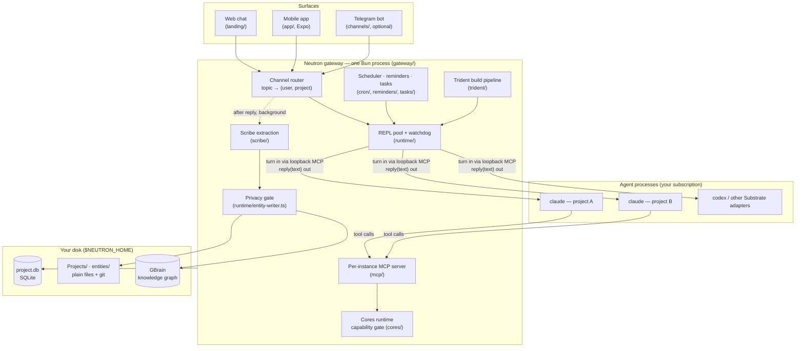

# Neutron

[](https://github.com/rjunee/neutron/actions/workflows/ci.yml)
[](LICENSE)

**Neutron is a self-hosted agent harness. It runs a fleet of long-lived Claude
Code sessions on your own machine, one per project, and gives you one place to
talk to all of them.**

Claude Code is a great agent, but a raw CLI session forgets you when it exits.
It can't run on a schedule, and you can only reach it from the terminal it was
started in. Neutron supplies the rest. It spawns and supervises the sessions and
routes each message to the right project. It keeps durable memory of who you are
and what you're working on, runs scheduled and autonomous jobs, and serves a web
app and a mobile app so you can reach your agents from anywhere. The model work
happens inside the `claude` binary. Neutron handles the orchestration.

**Who it's for:** people who already use Claude Code (or Codex) every day and
want it to work as an always-on agent system across many projects. It runs on
your own hardware, under your own subscription, with your data in plain files
on your own disk.

**Why it exists:** I ran my work through a homemade agent system for a long time.
In that system the rules lived in prompts and conventions, and the agents kept
breaking them. Neutron is the rebuilt version, and its main idea is that **a
rule only holds if code enforces it**. A required reply is a `Stop` hook, a
privacy boundary is a write gate, and a build that claims a test guards its
change has to show that test going red when the change is reverted. The longer
story is in [Why I built Neutron](https://ryanjunee.com/posts/why-neutron).

> **Status: pre-release.** The architecture below is real and runs, but expect
> rough edges and breaking changes. Don't depend on it yet. Watch the repo for
> the first release.

**Read more:**
[Neutron is open source](https://ryanjunee.com/posts/neutron-is-open-source) ·
[Why I built Neutron](https://ryanjunee.com/posts/why-neutron) ·
[Build your own Neutron](https://ryanjunee.com/posts/build-your-own-neutron) ·
For teams and operators: [Neutron Enterprise](https://github.com/rjunee/neutron-enterprise)

---

## What it does

Each item below is backed by code in this repo, and the paths point to it.

- **One persistent agent per project.** A pool of warm, long-lived `claude`
  REPLs, one per conversation. Context lives in the process and is not replayed
  each turn. A watchdog respawns a wedged or crashed REPL with `--resume`, so
  the conversation survives. REPLs run in [herdr](https://herdr.dev) panes by
  default. A gateway restart re-adopts them with their conversations intact
  (`runtime/adapters/claude-code/persistent/`, `watchdog/`).
- **Memory that builds up as you talk.** After every reply, `scribe/` pulls
  entities, facts and typed relations out of the turn and writes them to a
  personal knowledge graph ([GBrain](https://github.com/garrytan/gbrain)). This
  runs in the background, so it never blocks chat. Onboarding can bulk-import
  your ChatGPT, Claude or Gemini history, so the agent knows you from the first
  session.
- **Local search over your own corpus.** The agent can search your project docs
  (`doc-search/`) and your chat history (`message-search/`) with SQLite FTS5.
  This needs no SaaS and no embedding provider.
- **Scheduled and autonomous work.** An in-process scheduler handles time zones
  and missed fires: if the laptop sleeps through 09:00, the job fires once on
  wake (`cron/`). Context-aware reminders and a task store with a focus score
  run on top of it.
- **Autonomous build pipeline (Trident).** `/code <task>` plans, builds, reviews
  and publishes a change on its own worktree, with deterministic gates between
  the agents. [More below](#trident-autonomous-builds-with-gates-agents-cant-talk-past).
- **Plugin system (Cores).** Capability-gated plugins with a single Zod manifest
  contract. Nine ship in the box: tasks, reminders, calendar, email, Google
  Workspace, research, code-gen, scraping and agent settings (`cores/`).
- **Surfaces.** A bundled web chat, an Expo mobile app (`app/`) and an optional
  Telegram bot (`channels/`). One cross-channel button primitive
  (`ButtonPrompt`) renders the same "agent asks, you tap or type" prompt on all
  three.
- **Swappable model backend.** The runtime talks to a formal `Substrate`
  interface (`runtime/substrate.ts`). Claude Code is the default adapter. Codex
  CLI and OpenAI Responses API adapters already conform, and a local model is
  just another adapter (`runtime/adapters/`).
- **Cross-instance sharing (Connect).** A project can span independently run
  Neutron instances, with one owner, any number of collaborators and a
  default-deny replication allowlist (`connect/`).
- **A privacy wall.** Every durable memory write goes through one gate
  (`runtime/entity-writer.ts`). The gate refuses any write that didn't come from
  you or an explicitly allowlisted collaborator.

---

## Architecture



### The design choice everything else depends on: the agent is a Claude Code process

Neutron does not call the Anthropic API. Every model turn, whether a chat reply,
an onboarding classification or a research synthesis, goes into a real `claude`
CLI process that Neutron spawns and supervises. Neutron handles channels, state,
scheduling, memory and buttons. When a decision needs judgment, it hands the
turn to a session that already has Claude Code's full harness: tools, file
access, transcripts and resume.

- **You bring your own Claude.** `claude setup-token` attaches your own
  subscription. An Anthropic API key also works.
- **The `claude` binary owns the model relationship**: headers, OAuth refresh
  and signatures. Neutron feeds a turn in and takes one reply out. It never
  holds your credentials in an HTTP client of its own.

### How a server holds a conversation with a CLI

- **One warm REPL per conversation**, keyed by `(instance, user, project,
  credential)`. The same process serves turn after turn.
- **The terminal is not the data path.** `claude` needs a real terminal to boot,
  so each REPL runs in a herdr pane, or on an in-process PTY if
  `NEUTRON_REPL_HOST=bun` is set. Turn data never travels as keystrokes or
  screen-scraping. The gateway sends each turn through a small per-session
  loopback MCP server, and the REPL answers by calling its `reply(text)` tool. A
  `Stop` hook guarantees exactly one reply per turn.
- **Self-healing.** A registry records each session's resumable id. The watchdog
  detects a wedged or crashed REPL and respawns it with `--resume`, with guards
  against double-spawns and orphaned duplicates.

### One turn, end to end

```
 you type "what's blocking the launch?" (web, app or Telegram)
      │
      ▼
 channel router ── topic → (user, project); button taps short-circuit here
      │
      ▼
 REPL pool ── warm REPL for this project? reuse : spawn `claude`
      │
      ▼
 ┌─ claude (your subscription) ───────────────────────────────┐
 │  turn arrives via the loopback MCP server                  │
 │  reads project files, queries memory, calls Core tools     │
 │  (capability-gated), may run its own sub-agents            │
 │  answers by calling reply(text) — one reply per turn       │
 └────────────────────────────────────────────────────────────┘
      │ reply resolves the turn
      ▼
 delivered back to the surface you typed on
      │
      └─ in the background: scribe extracts entities, facts and
         relations → privacy gate → memory pages + graph edges
```

Memory is a side effect of talking. Extraction runs after the reply path, so it
can never block or break chat.

---

## Trident: autonomous builds with gates agents can't talk past

Trident (`trident/`) sits behind the `/code` command and the Work board. It
takes a task and builds it on a dedicated git worktree
(`trident/build-workspace.ts`), reviews it and publishes a PR. In between, the
host runs deterministic gates, so no agent's own say-so moves a change forward:

- **Planner-selected strategy.** A planner proposes building the task in one
  pass or as a task sequence. The host validates and records that decision
  before any builder runs (`trident/execution-strategy.ts`).
- **Cross-model review.** When the Codex CLI is installed, a second model
  family reviews the diff, so Claude doesn't grade its own work
  (`trident/codex-review.sh`, `trident/review-run.ts`). Without Codex, review
  falls back to Claude only.
- **Mutation prover.** Before a merge, the prover breaks the production line the
  PR's behavior depends on, in a throwaway worktree. It then watches the guard
  test go red and come back green. No agent writes the evidence. Plain
  TypeScript records what happened (`trident/mutation-prover.ts`).
- **Leak preflight.** The public-repo purity gate runs on the branch's own tree
  before a PR opens (`trident/leak-preflight.ts`).
- **Tool-less arbiter.** A judge with no filesystem tools decides build
  escalations such as rebase conflicts. It sees the evidence only as quoted data (`trident/arbiter.ts`).
- **Restart-safe runs.** Durable checkpoints, liveness tracking and recovery
  mean a gateway restart doesn't lose work that is in flight.

Trident is still being hardened against live use. `SPEC.md`'s Decisions Log
records its failure rates and fixes as measured, not as hoped.

---

## Quickstart (self-host)

### Prerequisites

- **[Bun](https://bun.sh) 1.4.2+.** The installer offers to install it if it's
  missing.
- **`git`.**
- **The [`claude`](https://docs.claude.com/en/docs/claude-code) CLI**, plus
  either a Claude subscription (`claude setup-token`) or an Anthropic API key.
- **[herdr](https://herdr.dev)**, the default terminal host for REPLs
  (`brew install herdr`). Keep a herdr session running, and Neutron connects to
  it over its socket. To run without herdr, set `NEUTRON_REPL_HOST=bun` in
  `.env`, which uses the in-process PTY host instead. **The installer does not
  install herdr for you.**
- **Optional:** `gbrain` for knowledge-graph memory (installed by default), the
  Codex CLI for cross-model review (installed by default; skipping it is
  non-fatal), and a Telegram bot token if you want the Telegram surface.

### Install

From a clone, in an interactive terminal (recommended):

```bash
git clone https://github.com/rjunee/neutron.git && cd neutron
sh install.sh
```

The installer installs dependencies and writes `.env` from `.env.example`. It
runs the database migrations, installs `gbrain` and the Codex CLI, and runs
`claude setup-token` for you. It then installs a boot and crash-restart service
(launchd on macOS, systemd on Linux), sets up the `neutron` CLI, schedules data
backups and starts the server. At the end it prints the chat URL, by default
`http://127.0.0.1:7800/chat`.

Or with one line:

```bash
curl -fsSL https://raw.githubusercontent.com/rjunee/neutron/main/install.sh | sh -s -- --yes
```

A piped install has no terminal for the browser sign-in. It does everything up
to Claude auth and then **stops before installing the service or starting the
server**, so it never starts a chat that can't answer. Finish it like this:

```bash
claude setup-token          # add the printed CLAUDE_CODE_OAUTH_TOKEN=… to the .env it names
neutron install             # installs the service and starts it
```

You can set `ANTHROPIC_API_KEY=…` in `.env` instead. Opt-outs: `--no-start`,
`--no-service`, `--no-gbrain`, `--no-codex`, `--no-backup`, `--no-open`. Run
`sh install.sh --help` for the rest.

### Check that it's up

```bash
curl localhost:7800/healthz
```

This returns a JSON status. It reports `"status":"degraded"` with
`"memory":"unavailable"` if you installed without `gbrain`. Open
`http://127.0.0.1:7800/chat`. On first visit, an onboarding interview asks who
you are, optionally imports your chat history, connects your Claude
subscription and opens your first projects.

### Run it by hand (no service)

```bash
bun install
cp .env.example .env        # every value has a default; use $HOME, not ~, in paths
bun run migrate             # creates/migrates the database the server will open
bun run start               # onboarding + chat at http://127.0.0.1:7800/chat
```

### Day to day

```bash
neutron status | restart | logs | stop | backup | url
```

### Where your data lives

- `$HOME/neutron/core`: the code (`NEUTRON_SRC_DIR`).
- `$HOME/neutron/data`: your data (`NEUTRON_HOME`). This holds auth, the
  registry, `project.db` (one SQLite database holds all operational state),
  `Projects/` (one plain folder per project) and `entities/` (memory as
  markdown). A deterministic git backup of this directory runs every 12 hours.
  Set `NEUTRON_BACKUP_REMOTE` to also push it offsite.

`sh uninstall.sh` removes the service, CLI, code and data. It lists each path
and asks before deleting anything.

> **Security:** the gateway binds loopback (`127.0.0.1:7800`) by default. Don't
> expose it beyond localhost (`NEUTRON_HOST=0.0.0.0`) without a trusted network
> or your own authenticating reverse proxy in front of it. See
> [SECURITY.md](SECURITY.md).

---

## Repository layout

A Bun workspace, grouped into five layers (bottom-up):

| Layer | Packages |
|---|---|
| Product surfaces | `onboarding/` `app/` `landing/` `prompts/` |
| Cores | `cores/sdk` (manifest contract) · `cores/runtime` (install + capability gate) · `cores/free/*` |
| Memory | `gbrain-memory/` `scribe/` `runtime/entity-writer.ts` · `doc-search/` `message-search/` |
| Substrate / runtime | `gateway/` (composition root) · `runtime/` (Substrate + adapters + credential pool) · `persistence/` `migrations/` `cron/` `reminders/` `tasks/` `tools/` `mcp/` `watchdog/` · `trident/` |
| Edge / transport | `channels/` (Telegram, buttons, app WebSocket) · `landing/` (web chat server + auth gate) · `auth/` · `connect/` |

**Cores** are packages with a `"neutron"` manifest block that declares their id,
capabilities, tools, secrets and data namespace. The design locks in one
invariant: **the runtime cannot tell a free Core from a paid one.** There are no
license checks, no entitlement tables and no heartbeats. If you can
`bun install` a Core, you can run it.

Deeper references: [`SPEC.md`](SPEC.md) is the current target plus an immutable
Decisions Log. [`docs/SYSTEM-OVERVIEW.md`](docs/SYSTEM-OVERVIEW.md) explains how
it works now, and [`docs/INVARIANTS.md`](docs/INVARIANTS.md) lists the
invariants that hold the design together.

---

## Contributing

Issues and PRs are welcome. Start with [CONTRIBUTING.md](CONTRIBUTING.md): it
covers running the partitioned test suite (`bash scripts/run-tests.sh`, not bare
`bun test`) and reproducing CI locally. Report security issues privately, as
described in [SECURITY.md](SECURITY.md).

## License

[Apache License 2.0](LICENSE).
